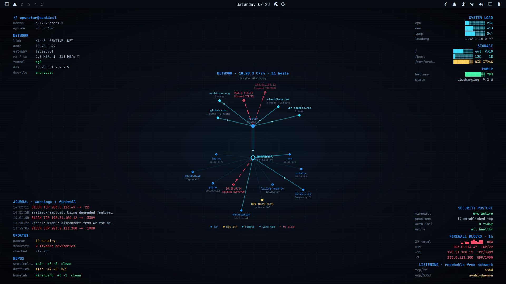

# Sentinel HUD

A live system, network and security heads-up display drawn straight onto
your Wayland desktop, under every window. Built on
[Quickshell](https://quickshell.org). Every readout comes from the real
system; nothing on screen is decorative.



<sub>Screenshot uses the made-up data in `demo/` (see [Demo mode](#demo-mode)).</sub>

- **Identity & network**: user@host, kernel, uptime, link/SSID, address,
  gateway, live rx/tx, VPN tunnels, DNS servers and whether DNS-over-TLS is on
- **System load**: CPU, memory, CPU temperature, load average, disks, battery
- **Security posture**: ufw status, established TCP sessions, auth failures
  today, failed systemd units, firewall blocks over the last hour (sparkline
  + top sources), and services listening on non-loopback addresses
- **Journal**: latest warnings, with firewall blocks highlighted
- **Updates**: pending pacman updates and fixable security advisories
  (`arch-audit`), checked at most hourly
- **Repos**: branch, ahead/behind and dirty state of your git checkouts
- **Network map**: this host, the gateway, every LAN device in the neighbour
  table (with mDNS names and MAC vendors), remote hosts grouped by domain,
  live TCP links and firewall blocks. Devices first seen in the last 24h are
  marked new.

The layer is view-only: it takes no input, and clicks pass through to the
desktop.

## Requirements

- **Arch Linux** (or a derivative): the update panel uses `checkupdates` and
  `arch-audit`
- A compositor with **wlr-layer-shell**: Hyprland, Sway, niri, river, KDE
  Plasma, Wayfire, … (GNOME is not supported)
- **systemd** (journal, resolved, unit status)

```bash
sudo pacman -S --needed quickshell jq iproute2 pacman-contrib hwdata
# optional
sudo pacman -S --needed arch-audit networkmanager ufw nmap avahi git ttf-jetbrains-mono-nerd
```

## Install

### Arch package (any compositor)

```bash
git clone https://github.com/usernamenotused/sentinel-hud.git
cd sentinel-hud
makepkg -si
```

### Without packaging (any compositor)

```bash
git clone https://github.com/usernamenotused/sentinel-hud.git
cd sentinel-hud
./install.sh
```

Both give you a `sentinel-hud` command. Start it from your compositor:

| Compositor | Config line |
|---|---|
| Hyprland | `exec-once = sentinel-hud` |
| Sway | `exec sentinel-hud` |
| niri | `spawn-at-startup "sentinel-hud"` |
| river | `riverctl spawn sentinel-hud` in `init` |

To try it without installing, run `qs -p .` from the checkout.

### Omarchy

The repo is also an Omarchy shell plugin, with a matching theme in `theme/`.
On Omarchy the HUD shows only while the `sentinel` theme is active.

```bash
git clone https://github.com/usernamenotused/sentinel-hud.git
cd sentinel-hud
./install.sh --omarchy
omarchy theme set sentinel
```

Or install just the plugin with
`omarchy plugin add https://github.com/usernamenotused/sentinel-hud.git --enable`,
then copy `theme/` to `~/.config/omarchy/themes/sentinel/`.

## Configuration

Settings live in `~/.config/sentinel-hud/` (the installer seeds them):

- **`config`**: bash syntax. Sets `REPO_ROOTS`, the directories searched for
  git repos. See `config.example`.
- **`sweep-networks`**: opt-in active discovery. By default the network map
  is passive: it only reads the kernel neighbour table, sockets and the
  firewall log. If the current gateway's MAC is listed in this file, the HUD
  also ping-sweeps the local /24 every 5 minutes so quiet devices show up.
  **Only list networks you own or are authorised to scan.** See
  `sweep-networks.example`.

Cached state (update counts, known devices, name lookups) lives in
`~/.local/state/sentinel-hud/`. To force an immediate update re-check:

```bash
rm ~/.local/state/sentinel-hud/updates
```

## Demo mode

`SENTINEL_HUD_DEMO=1` makes the HUD show the made-up data in `demo/` instead
of your machine's. Use it for screenshots, so you don't publish your IPs,
device names or Wi-Fi name, or to work on the layout:

```bash
SENTINEL_HUD_DEMO=1 qs -p .
```

## Notes

- Everything runs as your user. Nothing needs root.
- The firewall panels read `ufw` log lines (`[UFW BLOCK]`). Under other
  firewalls they stay empty.
- CPU temperature is read from `x86_pkg_temp` (Intel) or hwmon `k10temp` /
  `zenpower` / `coretemp`.

## License

MIT
